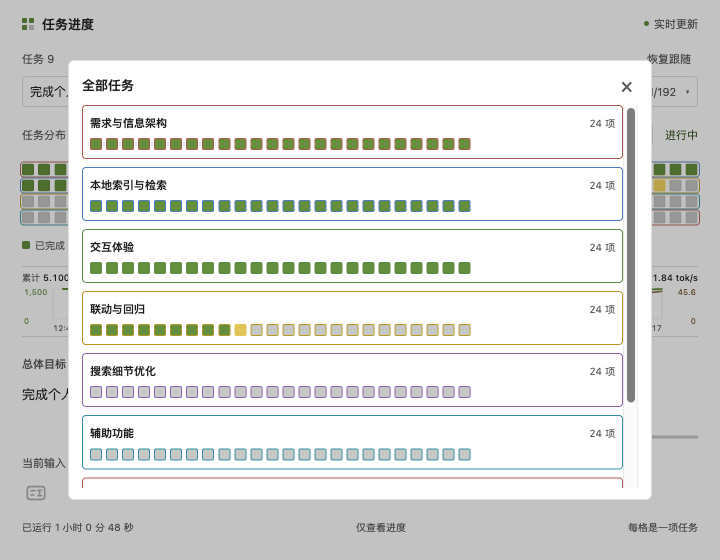

<p align="center"></p>
<h1 align="center">Codex Progress</h1>
<p align="center">把 Codex 任务进度放进 macOS 菜单栏。</p>

<table>
<tr>
<td width="33%"><a href="docs/assets/screenshot-overview.png"></a></td>
<td width="33%"><a href="docs/assets/screenshot-task-picker.png"></a></td>
<td width="33%"><a href="docs/assets/screenshot-history.png"></a></td>
</tr>
<tr><td align="center">任务概览</td><td align="center">任务切换</td><td align="center">历史阶段</td></tr>
</table>

<p align="center"><sub>实际界面截图，使用演示任务数据；点击图片查看大图。</sub></p>


Codex Progress 是一个独立的 macOS 伴随工具：自动观察本机 Codex 执行记录，用小网格展示子任务、历史阶段、Token 用量和执行速率。点击菜单栏图标即可展开进度窗口。

非 OpenAI 官方产品，不修改 Codex 应用本体。

## 功能

- 紧凑的任务网格，固定四行；每格代表一个实际子任务。完成绿色、进行中黄色、异常红色。
- 同一目标的多个执行阶段按时间保留，容量不足时可查看全部任务。
- 多任务下拉切换，按完成状态分类并分页；子代理独立展示状态和可见输出。
- 总体目标、当前输入及人工输入历史；目标优先于最近输入展示。
- 累计 Token 及双平均速率曲线，包含工具执行和等待时间。
- 菜单栏最多显示九个相邻任务状态，优先定位进行中任务；指标轮换但宽度固定。
- 可接管会话支持输入、运行中补充、停止执行、目标暂停/继续、附件、草图、技能和设置。
- 独立“状态问询”读取所选任务日志，不向原任务发送输入。
- 首次索引显示与 Logo 一致的加载动画，支持系统深色模式与减少动态效果。

## 安装

支持 **macOS 13.5+，Apple 芯片及 Intel Mac**。应用和内置运行环境都为 Universal；使用者无需安装 Node、Homebrew 或开发工具。

从 [Releases](https://github.com/a895047059/codex-progress/releases) 下载可用的 DMG，拖入 Applications，再从应用程序打开。仓库首次发布若尚无二进制 Release，请按下面步骤从源码构建。旧版更新前先退出旧版。

当前构建使用本地完整性签名，尚未完成 Apple Developer ID 公证；系统首次打开可能拦截。请确认来源后按系统安全设置操作，不需要关闭系统安全保护。完整说明见 [INSTALL.md](INSTALL.md)。

## 覆盖范围与限制

本工具显示这台 Mac 当前用户有本机执行记录的 Codex 任务。普通 ChatGPT 对话和完全云端、没有本机记录的任务不能自动接入；安装包不包含任何人的任务记录。

控制能力取决于 Codex 桌面控制服务是否已加载该会话并接受直接输入。不支持接管的任务仅展示进度；不会为了接管而恢复或复制原会话。输入框是本工具实现，并非 Desktop 原生输入框的完整嵌入。

日志格式和控制接口属于兼容适配层，未来 Codex 更新可能需要调整。Token 表示处理用量，包含输入与输出，缓存与推理子集不重复计数；曲线按窗口差值/实际时间求平均，不能仅凭曲线认定服务拥堵。

录制技能入口已隐藏，相关实现保留，不作为现有可用功能宣传。Cursor 主动附加需安装 [辅助扩展](editor/README.md)。

## 从源码构建

构建机器需要 macOS 与 Xcode Command Line Tools，网络用于下载官方 Node LTS 运行环境。构建后运行无需额外安装依赖。

```sh
git clone https://github.com/a895047059/codex-progress.git
cd codex-progress
bash scripts/prepare-runtime.sh
bash native/build.sh
open "Codex Progress.app"
```

`prepare-runtime.sh` 获取官方 Node 24.18.0 的 arm64/x64 归档，校验官方 SHA-256 清单。构建脚本将两个架构合并并打包运行环境，同时附带 Node 许可证。

```sh
"Codex Progress.app/Contents/Resources/runtime/node" --test tests/*.test.mjs
bash scripts/package.sh
```

打包生成dist/ 目录下的 `Codex-Progress-1.1-Universal.dmg` 和 SHA-256 文件。可通过 `CODEX_PROGRESS_SIGN_IDENTITY` 指定自己的签名身份；默认仅本地签名，不执行公证。请勿将未公证构建描述为 Apple 已认证。

当前自动测试 130 项通过；Apple 芯片上已验证移动应用目录、独立 HOME、最小 PATH、只读 DMG 内置运行环境启动。Intel 架构已编译并检查包结构，尚无 Intel 实机运行证据。

## 数据与隐私

服务仅监听 `127.0.0.1` 随机端口，页面通过 WebSocket 更新。默认观察 `~/.codex/sessions`；运行数据位于 `~/Library/Application Support/Codex Progress/runtime`，不在应用目录写入。

任务快照、人工输入历史和子代理详情来自本机记录。状态问询会通过已登录的 Codex 服务创建独立临时会话，将有限日志摘要交给模型分析；Cursor 附加仅在用户主动触发时读取当前文件或选区。问询历史单独保存在本机。使用相关功能前应确认内容适合交给当前 Codex 服务处理。

公开仓库不包含本机运行状态、日志、真实对话、构建缓存或认证信息。测试中的凭据样式字符串均为脱敏测试的虚构样例。

## 手动发布子任务

自动监听可以读取 Codex 计划事件，也可以通过进度工具发布明确的子任务。`CODEX_THREAD_ID` 存在时自动读取会话 ID，否则传入 `--thread`。

```sh
NODE="Codex Progress.app/Contents/Resources/runtime/node"
"$NODE" src/progressctl.mjs plan --thread <thread-id> <<'JSON'
{"goal":"完成一个具体目标","tasks":[{"id":"build","title":"实现功能","status":"in_progress"},{"id":"verify","title":"验证结果","status":"pending"}]}
JSON
"$NODE" src/progressctl.mjs update --thread <thread-id> --task build --status completed
```

调整计划时保留任务 ID 与完成状态。全部完成后调用 `finish`；尚有未完成项时会拒绝结束。不会按时间或 Token 伪造百分比。

## 代码结构

| 目录 | 职责 |
| --- | --- |
| `native/` | Swift/AppKit 菜单栏、窗口、原生桥接和构建 |
| `src/` | 会话观察、进度模型、指标、控制与本地服务 |
| `web/` | 进度界面、图表、输入与状态问询 |
| `editor/` | Cursor 主动附加当前编辑器上下文的扩展 |
| `scripts/` | 运行环境准备、打包与可选真实验收脚本 |
| `tests/` | 自动测试与 Swift 图标验证 |

真实验收脚本带 `--live` 的操作会创建可清理的测试会话，请先阅读脚本；不要针对业务会话测试发送、停止或目标修改。

## 贡献与许可

欢迎通过 Issue 报告 Codex 版本兼容、任务发现或界面问题。提交日志前请删除人工输入、文件路径和敏感内容。

采用 [MIT License](LICENSE)。Node 等第三方组件保留各自许可证。感谢 [codex-pulse](https://github.com/qwertyerge/codex-pulse) 与 [CodexMeter](https://github.com/raycalrui/CodexMeter) 提供的公开思路参考。
